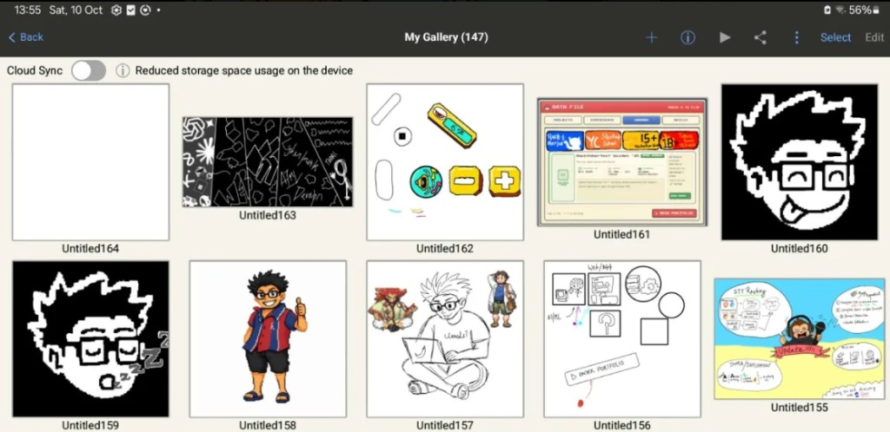

# portfolio v1.(lostcount bro)

live at [hariharann.me](https://hariharann.me)

`/` main card for people with less attention span ( me lowk ) 

and `/portfolio` is the 'professional' section under it so ppl can deep link the part they care about and quite elaborated as well

## how the routes sit

`/` is the card. flip it do whatever u want i am always thinking of ways to optimize this as it has lots of assets and it as its own mobile view too ( it looks like a pokemon tcg card )

`/portfolio` is the summary home. hero, the journey, a few projects, awards, and whats playing

then dedicated routes

- `/portfolio/experience`
- `/portfolio/projects`
- `/portfolio/skills`
- `/portfolio/achievements` (the nav just says awards)
- `/portfolio/blog` which is file based markdown under `content/blog` and

 each post ( or blog or yap ) lives at `/portfolio/blog/[slug]`


`/hari.md` and `/llms.txt` are the static dump for agents. no js. same words in both 


## the drawings

ive been drawing ever since i was 6 yo and was doing it proffesionaly ( was getting paid for it  ) since i was 16 yo i quit it when i became 18 to get into tech

 the illustrations on the site, the mascot and the panels and the little scenes, started as my own sketches in ibis paint and then an ai pass cleaned them into the assets that actually ship and work ( cba doing 70 different assets man when ai does it faster only) **the sketch is mine. the enhance pass is ai.**  

 BUTTTT the main mascot ( which is me ) was fully drew by me taking almost 30 + pokemon sprite into inspiration understanding their art style and everything and thats how me ( hari ) was born 0 AI was used in that 

the gallery shot is the originals sitting in ibis paint before that pass. longer pile is on https://www.deviantart.com/h4riharan

the oldest one dates back like 3 months ago



## stack

next.js 16 · react 19 · tailwind v4 · framer motion · typescript

deployed on vercel

## run it

```bash
npm install
npm run dev
```

open [http://localhost:3000](http://localhost:3000)

`/` is the card. `/portfolio` is the rest

```bash
npm run build
npm run start
npm run lint
```

## where the files live

```text
content/blog/          posts. one markdown file each
public/                sprites, honors, shots, audio, fonts, hari.md
src/app/               the routes above
src/components/card/   the trainer card
src/components/site/   the /portfolio pages
```

scratch stays out of git. `tmp/`, `*.preview.png`, `.env*`

## credits

pokemon ofc hope i dont get banned or something by nintendo

as for the minimal actual portfolio versions i took countless inspos like pretty much 1/5 portfolios now look that way anyway 


bgm in `public/audio` is original loops. the card typeface is a ds style pixel font for the look, not an official nintendo dump ( and those musics are js fav ones of mine from back in the day )

built / written  by hariharan ( no tokens were harmed )
